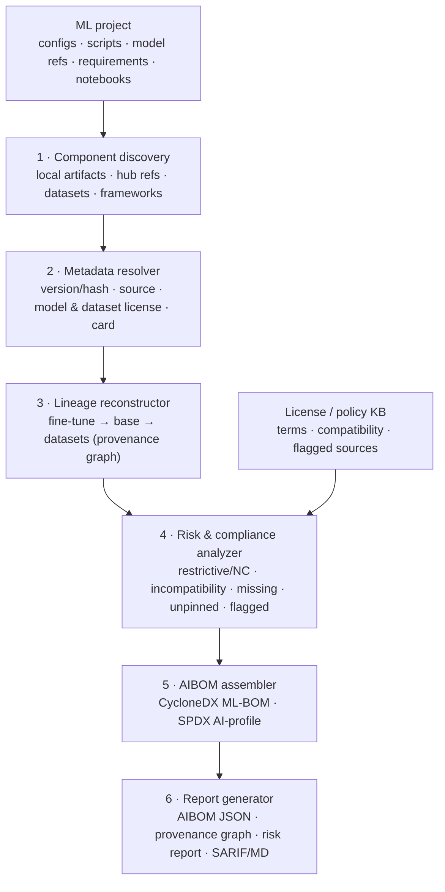
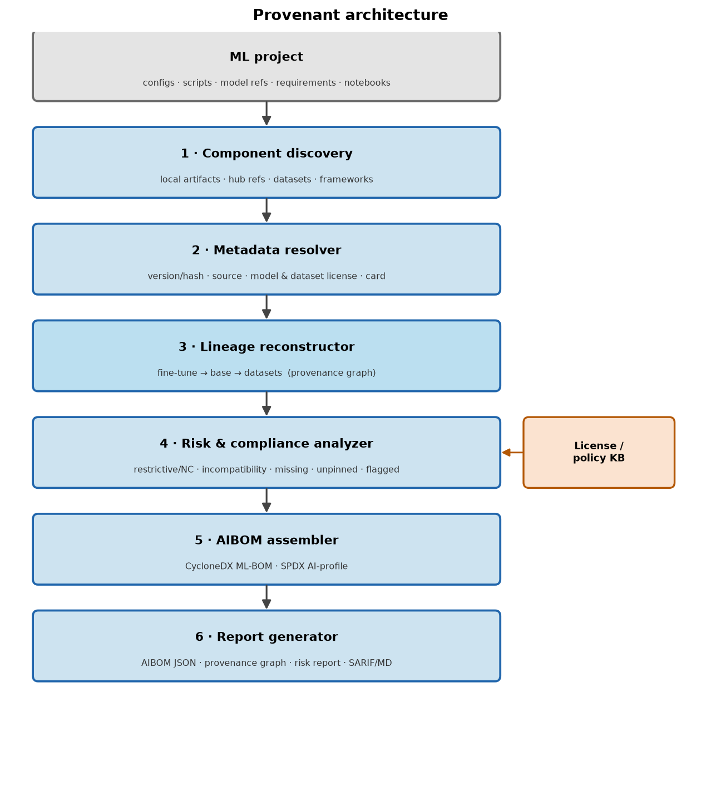
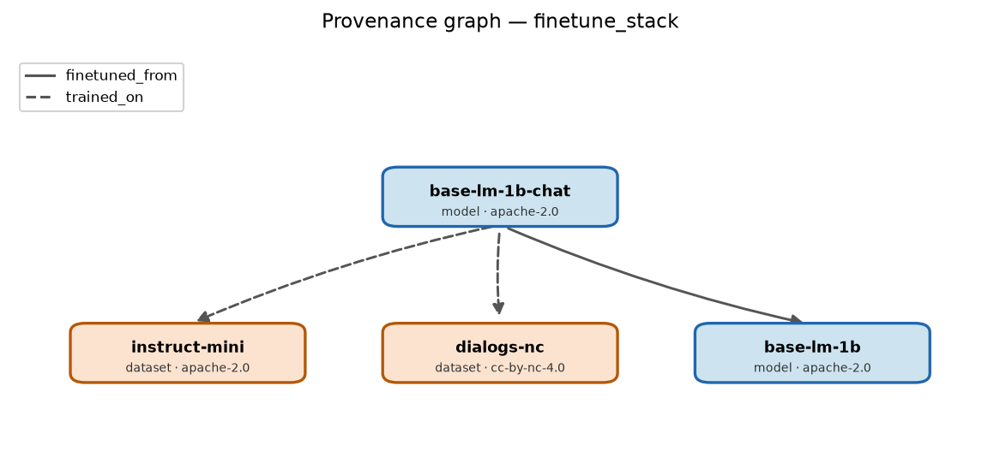
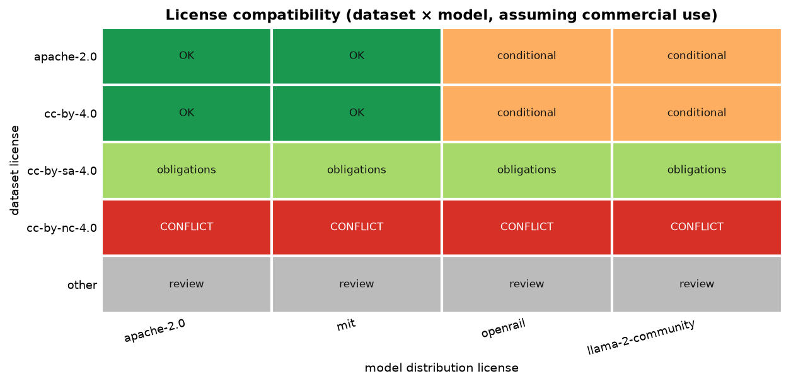
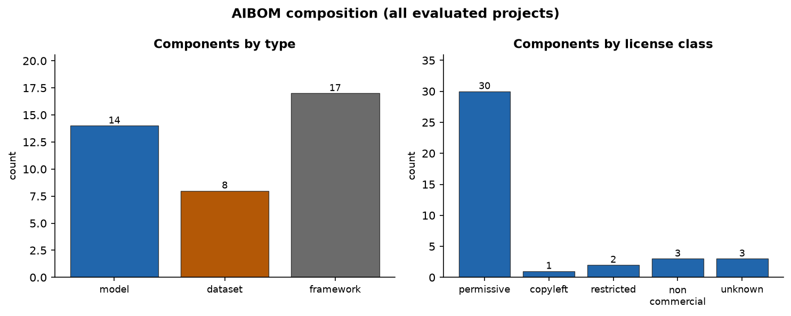
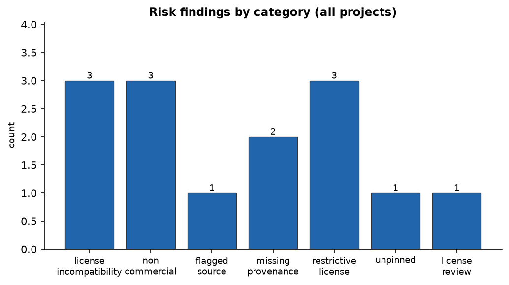
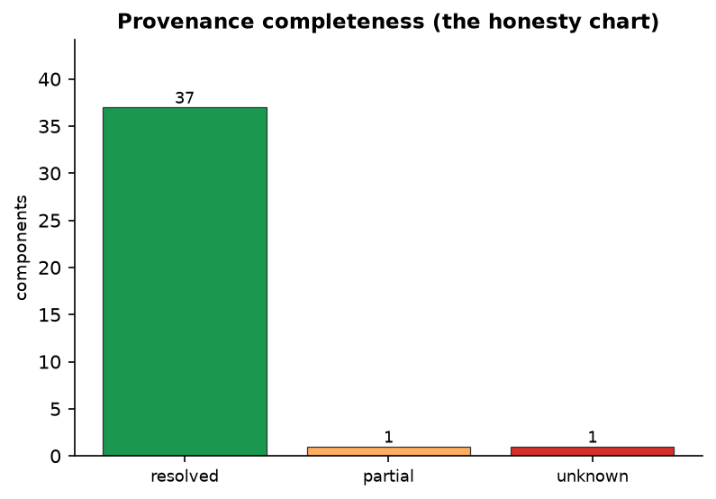
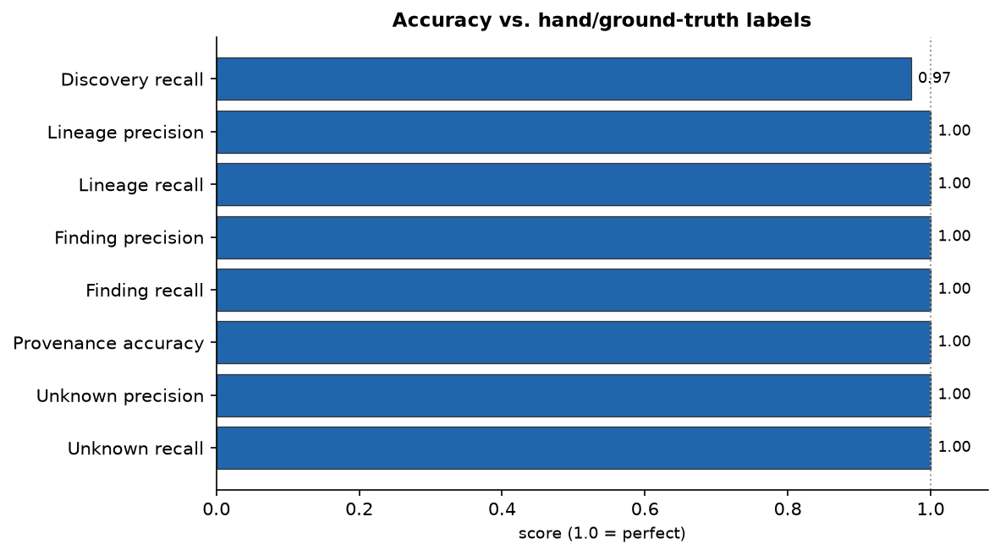
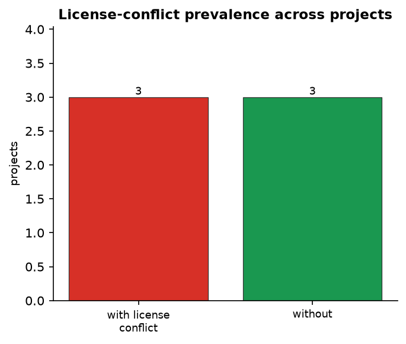

# Provenant

**An AI Bill of Materials (AIBOM) generator for model & dataset provenance.**

> Walk your ML project and produce a standards-aligned AI Bill of Materials —
> every model, dataset, version, license and lineage link — plus a
> license-and-provenance risk report, for the AI supply chain that ordinary
> SBOMs ignore.

Author: **Krishita Sanjay Choksi** · License: MIT · Status: research prototype

> **⚠️ Informational, not legal advice.** Provenant supports human governance
> review. License classifications and compatibility findings are informational
> and must be confirmed by someone qualified for licensing decisions.
> Unresolvable provenance is reported as `unknown` rather than guessed, and the
> bill of materials is a point-in-time artifact. See
> [`docs/scope_and_provenance.md`](docs/scope_and_provenance.md).

---

## Why Provenant

A traditional Software Bill of Materials (SBOM) lists your code dependencies —
but it is blind to the things that actually define an AI system: the **models**
you load, the **datasets** they were trained or fine-tuned on, their
**licenses**, their **versions**, and their **lineage**. As AI supply-chain
risk, model-license violations and provenance requirements move from "nice to
have" to mandated (EU AI Act documentation duties, the emerging CycloneDX ML-BOM
and SPDX AI-profile standards, procurement rules), organizations must produce a
bill of materials for their AI — and have little tooling to generate one.

Provenant generates that answer. It walks an ML project, discovers its AI
components, resolves each one's metadata and license, reconstructs lineage into
a provenance graph, flags the license and provenance risks, and assembles a
standards-aligned AIBOM plus a human-readable report.

### What's novel

1. **AIBOM generation from a real project** — the standards (CycloneDX ML-BOM,
   SPDX AI-profile) now exist, but almost nothing *generates* a spec-compliant
   document from an actual project. This generation step is the project.
2. **Lineage as a graph, not a list** — reconstructing `fine-tune → base model →
   training datasets` from scattered config fields and model-card breadcrumbs,
   including multi-hop ancestry resolved transitively.
3. **AI-layer license-risk analysis** — model + dataset license compatibility
   *across the lineage*, surfacing conflicts (e.g. a commercial model trained on
   non-commercial data) that code-SBOM license tools never see.
4. **Honest provenance-gap accounting** — missing provenance is a first-class
   finding and a measured metric: the tool reports `unknown` rather than
   guessing, and its blind spots are quantified.

---

## Architecture





---

## Signature artifacts

### Component → source → license → lineage → risk

The worked example (`reports/finetune_stack/`, regenerable):

| Component | Type | Version | Source | License | Class | Provenance | Lineage parent | Risk |
| --- | --- | --- | --- | --- | --- | --- | --- | --- |
| opencorp/instruct-mini | dataset | v2 | huggingface | apache-2.0 | permissive | resolved | — | — |
| research-lab/dialogs-nc | dataset | v3 | huggingface | cc-by-nc-4.0 | non_commercial | resolved | — | **non_commercial** |
| transformers | framework | 4.38.0 | pypi | apache-2.0 | permissive | resolved | — | — |
| torch | framework | 2.2.0 | pypi | bsd-3-clause | permissive | resolved | — | — |
| acme/base-lm-1b | model | v1.0 | huggingface | apache-2.0 | permissive | resolved | — | — |
| myorg/base-lm-1b-chat | model | v1.0 | local | apache-2.0 | permissive | resolved | acme/base-lm-1b | **license_incompatibility** |

### Reconstructed provenance graph

A fine-tune of a fine-tune, with a non-commercial dataset high in the chain
(`reports/instruction_tune/` and the synthetic `multihop_finetune`):



### License compatibility (the policy KB, made visible)



---

## Results

Evaluated on **6 projects** (4 synthetic with auto-generated ground truth + 2
real-style with hand-labeled gold BOMs), fully offline:

| Metric | Score |
| --- | --- |
| Discovery recall (file-present components) | **0.97** |
| Lineage edges — precision / recall / F1 | **1.00 / 1.00 / 1.00** |
| License findings — precision / recall / F1 | **1.00 / 1.00 / 1.00** |
| Provenance-status accuracy | **1.00** |
| Provenance-gap honesty — unknown precision / recall | **1.00 / 1.00** |
| AIBOM schema validity (CycloneDX / SPDX) | **6 / 6** |

Per project:

| Project | Kind | Components | Edges | Findings | Discovery recall | Lineage F1 | Finding F1 |
| --- | --- | --- | --- | --- | --- | --- | --- |
| finetune_stack | synthetic | 7 | 3 | 2 | 1.00 | 1.00 | 1.00 |
| multihop_finetune | synthetic | 7 | 4 | 2 | 1.00 | 1.00 | 1.00 |
| rag_app | synthetic | 6 | 0 | 3 | 1.00 | 1.00 | 1.00 |
| vision_pipeline | synthetic | 6 | 2 | 3 | **0.83** | 1.00 | 1.00 |
| hf_sentiment | real | 6 | 2 | 1 | 1.00 | 1.00 | 1.00 |
| instruction_tune | real | 7 | 2 | 3 | 1.00 | 1.00 | 1.00 |

`vision_pipeline`'s sub-1.0 discovery recall is **deliberate and measured**: it
plants a raw-path dataset that no generic detector can see, so the tool quantifies
its own blind spot rather than hiding it (a missed component is a silent hole in
the BOM).

### Figures (all code-generated via `make figures`)

| | |
| --- | --- |
|  |  |
|  |  |
|  | |

---

## Sample AIBOM (CycloneDX ML-BOM)

A model component and a lineage edge from `reports/finetune_stack/aibom.cdx.json`:

```json
{
  "type": "machine-learning-model",
  "bom-ref": "model:myorg/base-lm-1b-chat",
  "name": "myorg/base-lm-1b-chat",
  "version": "v1.0",
  "licenses": [{ "license": { "name": "apache-2.0" } }],
  "properties": [
    { "name": "provenant:provenance_status", "value": "resolved" },
    { "name": "provenant:content_hash", "value": "sha256:91de06df17c2..." }
  ],
  "modelCard": { "properties": [{ "name": "summary", "value": "Chat fine-tune of acme/base-lm-1b." }] }
}
```

```json
{ "ref": "model:myorg/base-lm-1b-chat",
  "dependsOn": ["dataset:opencorp/instruct-mini", "dataset:research-lab/dialogs-nc", "model:acme/base-lm-1b"] }
```

An SPDX 2.3 (AI-profile) document is emitted in parallel
(`aibom.spdx.json`), mapping lineage to typed SPDX relationships
(`DESCENDANT_OF`, `GENERATED_FROM`).

## Sample risk report

From `reports/finetune_stack/report.md`:

> ### [HIGH] license_incompatibility — `myorg/base-lm-1b-chat`
> - **Rule**: `LIC-INCOMPAT-001` — A commercially-usable model has a
>   non-commercial component in its lineage.
> - **Finding**: Model 'myorg/base-lm-1b-chat' (Apache License 2.0) has a
>   non-commercial component 'research-lab/dialogs-nc' (CC-BY-NC-4.0) in its lineage.
> - **Recommendation**: A commercial release would inherit the non-commercial
>   restriction; re-source the component or restrict use. Confirm with someone
>   qualified.

Every finding cites the component and the rule/term it was derived from.

---

## Install

Prerequisites: Python 3.9+.

```bash
git clone https://github.com/Krishita17/provenant.git
cd provenant
python -m venv .venv && source .venv/bin/activate
pip install -r requirements.txt
pip install -e .
```

**Everything runs fully offline** against bundled synthetic projects and cached
metadata fixtures — no network access is required for any step. Online hub
resolution is an optional, read-only extension point and is never needed.

## Usage

Each stage is a Makefile target and writes an inspectable artifact:

```bash
make data       # generate synthetic ML projects + ground-truth BOMs (seed=7)
make discover   # discover AI components in $PROJECT
make resolve    # resolve component metadata (offline, from fixtures)
make lineage    # reconstruct the provenance graph
make analyze    # run the license/provenance risk analyzer
make bom        # assemble + validate the CycloneDX ML-BOM + SPDX AI-profile AIBOM
make report     # render the AIBOM + provenance graph + risk report
make all        # run the full pipeline on $PROJECT
make eval       # score discovery/lineage/license accuracy vs ground truth
make figures    # regenerate every figure and the architecture diagram
make test       # run the test suite
```

Run on any project directly:

```bash
PYTHONPATH=src python -m provenant.cli all path/to/ml-project --out results/out
```

Point a stage at a different project with `make all PROJECT=examples/real/instruction_tune OUT=results/it`.

---

## Reproducibility

* All synthetic data is a deterministic function of the specs and `--seed`
  (default `7`); `make data` reproduces byte-identical projects.
* The committed worked examples (`reports/`), figures (`figures/`) and metrics
  (`results/`) are regenerable: `make data && make eval && make figures`.
* AIBOM documents use a fixed timestamp and name-derived UUIDs, so regenerated
  documents are stable.
* Evaluation config: [`experiments/default.yaml`](experiments/default.yaml).

## Limitations

* **Discovery is signal-based** and can miss components it has no detector for
  (e.g. a dataset referenced only as a raw local path). Recall is measured, not
  assumed.
* **Metadata is point-in-time**, resolved from cached fixtures; re-run to
  refresh. Cached license snapshots for real identifiers must be reconfirmed
  upstream.
* **License findings are informational**, not a legal determination.

## Responsible use

The AIBOM and risk report **inform** human governance and procurement decisions;
they do not replace legal review. The repository redistributes **no** model
weights or datasets — components are referenced by identifier and hash only — and
the flagged-source list is an illustrative example, not a claim about any real
service. Provenant is a **defensive** tool: it statically reads a project and
reports on it, executing none of the code it scans. See
[`docs/scope_and_provenance.md`](docs/scope_and_provenance.md).

## AI supply-chain relevance

Provenant sits where software supply-chain security meets the ML stack — a space
where the standards now exist but the generators do not. It produces exactly the
artifacts a security, legal or procurement team needs to vet an AI system's
components: a machine-readable AIBOM that existing SBOM/vuln tooling can consume
(CycloneDX / SPDX / SARIF), and a human-readable provenance-and-license report
that makes the AI-specific supply chain — the models, the data, and the terms
that govern them — visible for the first time.

---

## Repository layout

```
provenant/
├── config/                 policy/license KB, flagged sources, output toggles
├── src/provenant/
│   ├── discover/           component discovery (models, datasets, frameworks)
│   ├── resolve/            metadata resolver (+ provenance-status classifier)
│   ├── lineage/            lineage reconstructor — the provenance graph
│   ├── policy/             license/compatibility knowledge base
│   ├── analyze/            risk & compliance analyzer (the rule engine)
│   ├── aibom/              CycloneDX ML-BOM / SPDX AI-profile assembler + schemas
│   ├── report/             report, provenance-graph and figure generators
│   ├── data/               synthetic project generator + cached metadata fixtures
│   ├── evaluate.py         scoring against ground truth
│   └── cli.py              command-line entry point
├── examples/               synthetic (generated) + real-style example projects
├── references/gold/        hand-labeled gold BOMs for the real-style examples
├── experiments/            reproducible evaluation config
├── results/ figures/ reports/   generated metrics, charts, worked examples
├── tests/                  discovery/lineage/analyzer/AIBOM/generator tests
└── docs/scope_and_provenance.md
```

## Citation

See [`CITATION.cff`](CITATION.cff).
