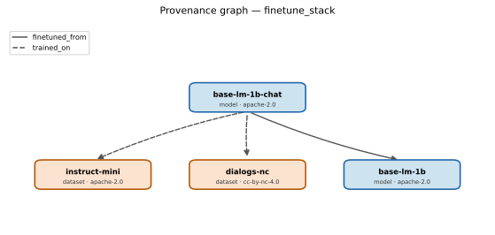

# AIBOM & Provenance Risk Report — `finetune_stack`

> **Informational, not legal advice.** This report supports human governance review. License classifications and compatibility findings are informational and must be confirmed by someone qualified for licensing decisions. Unresolved provenance is reported as `unknown` rather than guessed, and the bill of materials is a point-in-time artifact.

## Summary

| Metric | Value |
| --- | --- |
| Components | 7 |
|   models / datasets / frameworks | 2 / 2 / 3 |
| Provenance resolved / partial / unknown | 7 / 0 / 0 |
| Findings (total) | 2 |
|   high / medium / low / info | 2 / 0 / 0 / 0 |

## Components

The signature artifact: every component with its source, license, lineage parent and risk.

| Component | Type | Version | Source | License | Class | Provenance | Lineage parent | Risk |
| --- | --- | --- | --- | --- | --- | --- | --- | --- |
| opencorp/instruct-mini | dataset | v2 | https://huggingface.co/datasets/opencorp/instruct-mini | apache-2.0 | permissive | resolved | — | - |
| research-lab/dialogs-nc | dataset | v3 | https://huggingface.co/datasets/research-lab/dialogs-nc | cc-by-nc-4.0 | non_commercial | resolved | — | non_commercial |
| datasets | framework | 2.18.0 | https://pypi.org/project/datasets/ | apache-2.0 | permissive | resolved | — | - |
| torch | framework | 2.2.0 | https://pypi.org/project/torch/ | bsd-3-clause | permissive | resolved | — | - |
| transformers | framework | 4.38.0 | https://pypi.org/project/transformers/ | apache-2.0 | permissive | resolved | — | - |
| acme/base-lm-1b | model | v1.0 | https://huggingface.co/acme/base-lm-1b | apache-2.0 | permissive | resolved | — | - |
| myorg/base-lm-1b-chat | model | v1.0 | local | apache-2.0 | permissive | resolved | acme/base-lm-1b | license_incompatibility |

## Risk findings

### [HIGH] non_commercial — `research-lab/dialogs-nc`

- **Rule**: `LIC-NC-001` — Component is under a non-commercial license.
- **Finding**: Dataset 'research-lab/dialogs-nc' is under Creative Commons Attribution-NonCommercial 4.0 (non-commercial).
- **Recommendation**: Do not use in a commercial system without a separate grant; confirm the terms with someone qualified.
- **Evidence**: policy_kb: license 'cc-by-nc-4.0' class=non_commercial

### [HIGH] license_incompatibility — `myorg/base-lm-1b-chat`

- **Rule**: `LIC-INCOMPAT-001` — A commercially-usable model has a non-commercial component in its lineage.
- **Finding**: Model 'myorg/base-lm-1b-chat' (Apache License 2.0) has a non-commercial component 'research-lab/dialogs-nc' (Creative Commons Attribution-NonCommercial 4.0) in its lineage.
- **Related component**: `research-lab/dialogs-nc`
- **Recommendation**: A commercial release would inherit the non-commercial restriction; re-source the component or restrict use. Confirm with someone qualified.
- **Evidence**: analyzer: commercial model reaches a non-commercial component via provenance edges

## Provenance graph

## Method & limitations

- Discovery is signal-based and can miss components it has no detector for; recall is measured, not assumed.
- Metadata and licenses are a point-in-time snapshot resolved from cached fixtures; re-run to refresh.
- License findings are informational governance signals, not a legal determination.

