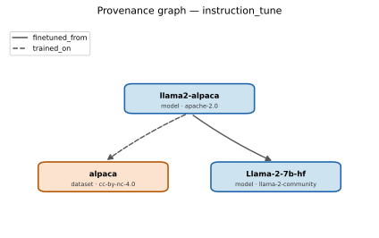

# AIBOM & Provenance Risk Report — `instruction_tune`

> **Informational, not legal advice.** This report supports human governance review. License classifications and compatibility findings are informational and must be confirmed by someone qualified for licensing decisions. Unresolved provenance is reported as `unknown` rather than guessed, and the bill of materials is a point-in-time artifact.

## Summary

| Metric | Value |
| --- | --- |
| Components | 7 |
|   models / datasets / frameworks | 2 / 1 / 4 |
| Provenance resolved / partial / unknown | 7 / 0 / 0 |
| Findings (total) | 3 |
|   high / medium / low / info | 2 / 1 / 0 / 0 |

## Components

The signature artifact: every component with its source, license, lineage parent and risk.

| Component | Type | Version | Source | License | Class | Provenance | Lineage parent | Risk |
| --- | --- | --- | --- | --- | --- | --- | --- | --- |
| tatsu-lab/alpaca | dataset | main | https://huggingface.co/datasets/tatsu-lab/alpaca | cc-by-nc-4.0 | non_commercial | resolved | — | non_commercial |
| accelerate | framework | 0.29.0 | https://pypi.org/project/accelerate/ | apache-2.0 | permissive | resolved | — | - |
| peft | framework | 0.10.0 | https://pypi.org/project/peft/ | apache-2.0 | permissive | resolved | — | - |
| torch | framework | 2.3.0 | https://pypi.org/project/torch/ | bsd-3-clause | permissive | resolved | — | - |
| transformers | framework | 4.40.0 | https://pypi.org/project/transformers/ | apache-2.0 | permissive | resolved | — | - |
| acme-user/llama2-alpaca | model | v1 | local | apache-2.0 | permissive | resolved | meta-llama/Llama-2-7b-hf | license_incompatibility |
| meta-llama/Llama-2-7b-hf | model | main | https://huggingface.co/meta-llama/Llama-2-7b-hf | llama-2-community | restricted | resolved | — | restrictive_license |

## Risk findings

### [HIGH] non_commercial — `tatsu-lab/alpaca`

- **Rule**: `LIC-NC-001` — Component is under a non-commercial license.
- **Finding**: Dataset 'tatsu-lab/alpaca' is under Creative Commons Attribution-NonCommercial 4.0 (non-commercial).
- **Recommendation**: Do not use in a commercial system without a separate grant; confirm the terms with someone qualified.
- **Evidence**: policy_kb: license 'cc-by-nc-4.0' class=non_commercial

### [HIGH] license_incompatibility — `acme-user/llama2-alpaca`

- **Rule**: `LIC-INCOMPAT-001` — A commercially-usable model has a non-commercial component in its lineage.
- **Finding**: Model 'acme-user/llama2-alpaca' (Apache License 2.0) has a non-commercial component 'tatsu-lab/alpaca' (Creative Commons Attribution-NonCommercial 4.0) in its lineage.
- **Related component**: `tatsu-lab/alpaca`
- **Recommendation**: A commercial release would inherit the non-commercial restriction; re-source the component or restrict use. Confirm with someone qualified.
- **Evidence**: analyzer: commercial model reaches a non-commercial component via provenance edges

### [MEDIUM] restrictive_license — `meta-llama/Llama-2-7b-hf`

- **Rule**: `LIC-RESTRICT-001` — Component license carries share-alike / acceptable-use / copyleft obligations.
- **Finding**: Model 'meta-llama/Llama-2-7b-hf' is under Llama 2 Community License (acceptable-use restrictions).
- **Recommendation**: Review the obligations (e.g. relicensing, redistribution or use-case limits) against your intended use.
- **Evidence**: policy_kb: license 'llama-2-community' class=restricted

## Provenance graph

## Method & limitations

- Discovery is signal-based and can miss components it has no detector for; recall is measured, not assumed.
- Metadata and licenses are a point-in-time snapshot resolved from cached fixtures; re-run to refresh.
- License findings are informational governance signals, not a legal determination.

